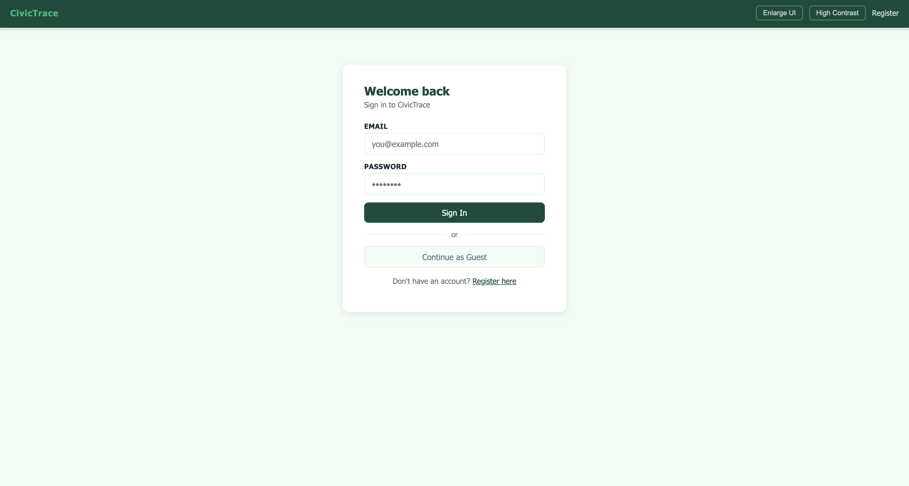
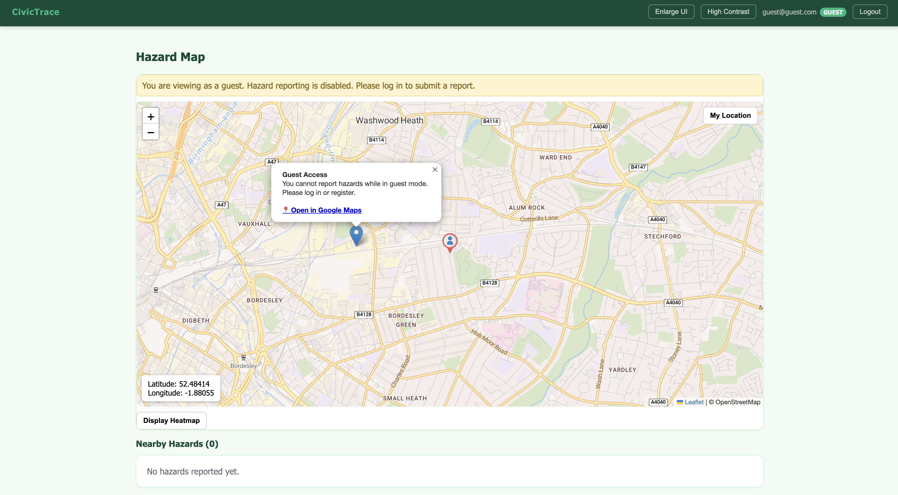

M.H Issues noticed - clicking on the same pin multiple times to submit and cancel submit a report can lead to duplicates being inputted, need a safeguard to fix this
2 - When you add a new report, since the data is not refreshed for performance, this will not be considered when generating the heatmap, need to add to the data ref when addinga report

Testing plan:

    Unit Testing: //tests database connection of features

        Universal Features: 

            Register{ 
                valid password and email
                no inputs
                syntactically invalid email address
                invalid text characters
            }

            Login{ 
                no inputs
                syntactically invalid email address
            }

            Report via report page{
                valid inputs for each category (Hazard category, description, severity, photo, lat/long)
                valid inputs for only necessary categories
                invalid inputs for each report category
                no inputs
                submit report multiple times
            }

            Report via map{ 
                valid inputs for each category 
                valid inputs for only necessary categories
                invalid inputs for each report category
                no inputs
                submit report multiple times
            }

            View heatmap{ 
                test each variation of time to see if they are correct (will need to create fake old report data for this)
            }

            Send message{
                send a valid message
                send a message with inappropriate language
                upvote a message
                view messages by amount of likes
            }

        Staff-only Features: 

            Update Hazard{
                sort hazards by all the different categories
                update each field of a hazard
            }

            Delete hazard{
                delete a hazard
            }

    Integration Testing:

        Universal Features:

            Login{ 
                valid password and email which have been registered
                valid but not registered email adress
                registered email address but incorrect password
            }

            View heatmap{
                add a report and then generate the heatmap, is this report included?
                Test that heatmap gneeration is based on previous data
            }

            Guest Restrictions{
                
                Input: 
                
                User will first click "Continue as Guest" on the login page and is sent to the map page and then user then clicks on the map to attempt to report a hazard.

                Goal: 
                
                The guest user should be able to view the map and hazards but should not be able to submit a hazard report and a message should be displayed indicating that reporting is disabled in guest mode.

                Actual Response To User Input: 
                
                Guest user was able to successfully be sent to the map page and could view hazards. When attempting to report a hazard via the map there was a popup message displayed stating that hazard reporting is disabled in guest mode and most importantly no report submission was allowed.

                Result: Pass 

                Evidence: 

                I have attatched two screenshots proving the goal was achieved.

                Screenshot 1 - Guest login page:

                Screenshot 2 - Guest map restriction message:

            }

        Staff-only Features: 

            Update Hazard{
                update a field and then view the heatmap
                update hazard and then check the map for the pin
            }

            Delete hazard{
                delete a hazard and then view the heatmap
                delete a hazard and then check the map for the pin
            }

